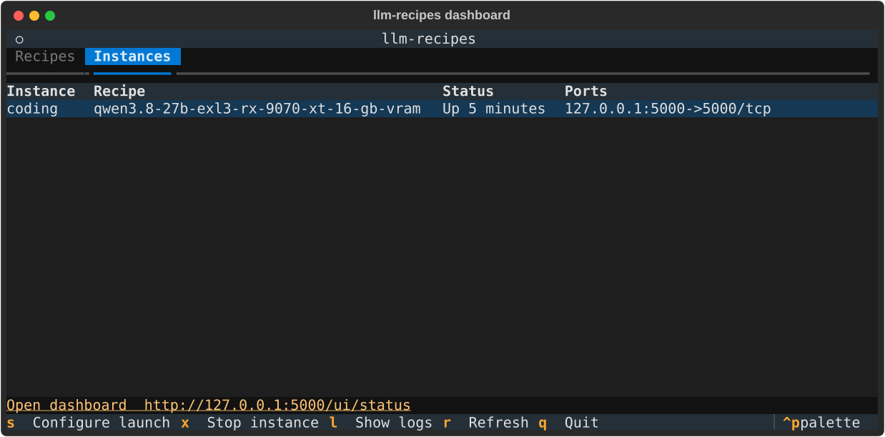

# Launcher guide

Serving normally runs through the installed `llm-recipes` command (the `~/.llm-recipes` snapshot; see [machine roots](project-instructions.md#machine-roots)). From the development checkout, run the equivalent `python3 scripts/launch.py` commands below from the repository root using Python 3.14 or later and `sudo docker`. Build the image and prepare models following the selected recipe's `setup.md`.

## Recipes and instances

A recipe defines a prepared model/server setup. An instance is one launch of that recipe. The API-server adapter controls startup; the inference engine performs inference. Supported combinations are `tabbyapi` / `exllamav3` and `strata` / `strata`.

```bash
llm-recipes list
llm-recipes start <recipe> --detach
llm-recipes ps
llm-recipes status <recipe>
llm-recipes logs <recipe> --follow
llm-recipes stop <recipe>
```

Replace `<recipe>` with a directory identifier from `list`. Without `--name`, the recipe identifier becomes the instance name. Names contain up to 160 lowercase letters, digits, dots, dashes, or underscores and start with a letter or digit. Distinct instances require distinct names and available host ports. Docker reports name or port conflicts.

`ps` discovers running instances through Docker labels. `status` reports container state; use the recipe's readiness endpoint or status page to confirm the model has loaded. `status`, `logs`, and `stop` select an instance independently of recipe discovery.

`status <instance> --json` returns `{"instance": "...", "status": "<container-state>"}`.
A successful query with no matching container returns `"status": "not-found"`; both cases
exit with code 0. Docker or authentication failures return `"status": "error"` with an
`error` message and exit code 1. Invalid command arguments exit with code 2.

## Diagnose a recipe

```bash
llm-recipes doctor <recipe>
```

`doctor` reads the recipe defaults and reports `PASS`, `WARN`, `FAIL`, or `SKIP` for:

- Docker daemon access and local image availability.
- AMD character devices (`/dev/kfd` and `/dev/dri/renderD*`).
- Native model paths and API port, plus the checked-in Pi model metadata.
- Preparation receipts, required artifacts, and Strata shard sizes.

It returns 1 if a check fails and 0 otherwise; warnings require review. Docker inspection uses `sudo -n` with a 15-second timeout per command. Start, lifecycle, and instance-list commands request sudo credentials at startup. `doctor` stays noninteractive; run `sudo -v` first if its Docker checks report an authentication failure. TabbyAPI configuration inspection needs PyYAML; use `.venv/bin/python` after [development setup](project-instructions.md#development-dependencies-and-checks) if the host Python lacks it.

The command creates no directories, downloads nothing, and starts no containers. It checks recipe defaults, not a running instance or launch overrides. It does not inspect your installed Pi settings, rehash weights, verify the image's embedded build lock, execute GPU kernels, or estimate whether the model fits memory. Follow the runtime image check and recipe generation checks for workstation validation.

## Foreground and background execution

| Command | Behavior | Ctrl+C |
| --- | --- | --- |
| `start <recipe>` | Runs attached to the server | Stops the server |
| `start <recipe> --detach` | Returns to the shell after starting the container | The server runs independently |
| `logs <instance> --follow` | Streams container console output | Ends log following; the server keeps running |

Use `stop <instance>` to stop a background server. Rerun its start command to restart it. Containers are removed on exit; mounted model files, caches, and file logs remain on the host.

## Launch options

Explicit CLI options override the recipe's launch defaults.

| Option | Default | Purpose |
| --- | --- | --- |
| `--name NAME` | Recipe identifier | Instance name |
| `--models DIRECTORY` | `LLM_RECIPES_HOME` or `~/llm-recipes` | Models root |
| `--logs DIRECTORY` | `<models root>/logs/<instance>` | Persistent server file logs |
| `--port PORT` | Manifest port | Host loopback port; update the client's API address when changed |
| `--context TOKENS` | Manifest context | Context capacity |
| `--draft on\|off` | Manifest drafting setting | Configured speculative decoding |
| `--vision on\|off\|cpu` | Manifest vision setting | TabbyAPI: `on/off` GPU vision; Strata: `cpu/off` CPU vision |
| `--detach` | Off | Background execution |
| `--dry-run` | Off | Print the command without creating directories or accessing GPU devices |

Both adapters accept contexts of at least 1,024 tokens in multiples of 256, up to nine digits. Model and memory limits still determine usable context. GPU device group IDs are resolved at actual startup; dry runs omit them.

Run `python3 scripts/launch.py start --help` (or `llm-recipes start --help`) for CLI help.

## Persistent logs

The default directory is `<models root>/logs/<instance>`. The launcher takes the root from `--models` when supplied, then `LLM_RECIPES_HOME`, then `~/llm-recipes`. Use `--logs` to choose another location, including an existing log directory.

`logs --follow` reads console output while the container exists. After it exits, read the files in the host log directory. Server-specific filenames, rotation, and retention are documented in the [runtime guides](#shared-runtimes).

After Docker confirms the container, the launcher, dashboard, and baseline runner record its ID, image, effective launch options, configuration hashes, and host facts in `facts.json`. A rejected start preserves the previous file. An ordinary launch warns if facts cannot be written. A baseline run reports the failure and attempts to stop its own container. `run_baseline.py session <instance>` and `run_baseline.py import` read it; the [session report](baseline.md#report-a-coding-session) uses it to seed experiment profiles.

Queries (`list`, `ps`, `status`) accept `--json` for machine-readable output.

### Terminal dashboard

Run `llm-recipes tui` after the normal installation. It asks for Docker credentials before opening.

On the Recipes tab, select a recipe and press **s**. The form starts with the recipe defaults. Press **Enter** on **Start** to accept them, or use **Tab** and **Shift+Tab** to edit the instance name, context, drafting, vision, and host port. The form previews the API address and log directory. **Reset defaults** restores the form, and **Esc** cancels before launch. Overrides apply to this instance.

If Docker rejects the start, the form keeps your values and shows the error. After Docker accepts it, the dashboard switches to Instances and selects the new instance when it appears. The status shows its API address while the model loads. Use **l** to follow logs, **x** to stop the selected instance, **r** to refresh, and **q** to quit. **Esc** closes the log view. Closing the dashboard leaves running instances active.



For development, run `.venv/bin/python scripts/tui.py` from the checkout.

## Launch manifest

The launcher discovers `recipes/*/config/launch.json`. The recipe directory supplies its identifier. Every manifest field is required:

| Field | Meaning |
| --- | --- |
| `runtime` | Directory identifier under `runtimes/`, such as `strata` or `exllamav3-tabbyapi` |
| `port` | Container API port and default host port |
| `context` | Default context capacity |
| `draft` | Default `on` or `off` |
| `vision` | TabbyAPI: `on/off`; Strata: `cpu/off` |

The selected runtime's `runtime.json` defines `adapter`, `engine`, and `image`. Supported pairs are `tabbyapi` / `exllamav3` and `strata` / `strata`. The launcher validates the runtime identifier and serving entry point before constructing a command. The recipe's model data folder is `<data home>/recipes/<recipe-id>/`, derived from the recipe folder name and not configurable. Native server settings remain recipe-local. Keep the native server port equal to the manifest port; `--port` changes only the host mapping. The [container recipe template](../templates/container/config/launch.json) selects the shared ExLlamaV3/TabbyAPI runtime.

## Shared runtimes

[ExLlamaV3 / TabbyAPI](runtimes/exllamav3-tabbyapi.md) and [Strata](runtimes/strata.md) each own a container build, dependency locks, preparation helpers, serving integration, and API checks. Multiple recipes can select one runtime while keeping their model locks, native configuration, data directories, and results independent. Select a recipe directly; model variants use separate recipe identifiers.

The launcher mounts the selected recipe at `/recipes/<recipe-id>` and runtime at `/runtime`, both read-only, plus prepared models at `/models` read-only and writable `/cache` and `/logs`. It then calls `/runtime/scripts/serve.py --recipe /recipes/<recipe-id>`. Preparation helpers also take an explicit recipe directory. Existing prepared files remain usable when model and build locks match.

[`scripts/launch.py`](../scripts/launch.py) handles CLI presentation. [`scripts/launcher.py`](../scripts/launcher.py) handles discovery, validation, command planning, and lifecycle operations. Docker labels record instance, recipe, runtime, API-server adapter, and engine. API-server integrations remain distinct from inference engines.

---

[All recipes](../README.md) · [Authoring](authoring.md) · [Pi setup](clients/pi.md) · [Development](project-instructions.md)
