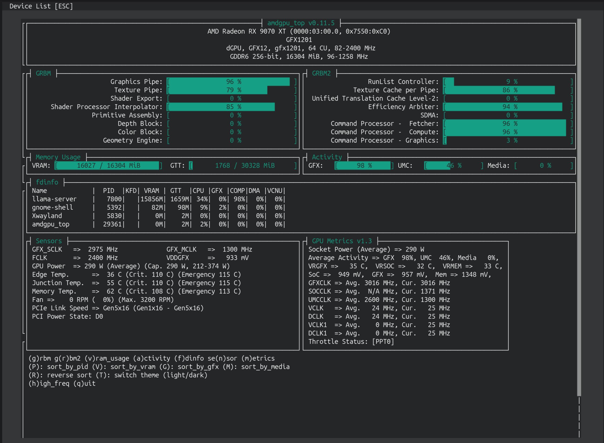

# RX 9070 XT 16GB: Qwen3.8-27B IQ3_XXS + MTP, 128K context — settings and results

Hardware and software: **AMD RX 9070 XT 16GB**, **Ubuntu 26.10 (Stonking Stingray)** with Linux kernel **7.3.0-10-generic**, **LM Studio Bionic + llama.cpp Vulkan**.

Workload: development of [gpu-switcher](https://github.com/wl04/gpu-switcher). All repository content was developed using this model. No repetitive loops were observed during development.

For my evaluation, a real-workload profile is more useful than standalone benchmark scores: it captures sustained coding work, growing context, repeated tool calls and context compaction. Overall experience with **LM Studio Bionic** has been positive.

Files from [ISTA-DASLab/Qwen3.8-27B-GSQ-RCO-GGUF](https://huggingface.co/ISTA-DASLab/Qwen3.8-27B-GSQ-RCO-GGUF/tree/main):

- `Qwen3.8-27B-GSQ-RCO-IQ3_XXS-mtp.gguf`
- `mmproj-Qwen3.8-27B-BF16.gguf`

## Configuration

| Setting | Value |
|---|---|
| Automatic hardware optimization | Off |
| Context length | 131072 |
| GPU offload | 65 (maximum in the UI) |
| CPU thread pool | 6 |
| Evaluation batch size | 2048 |
| Physical batch size | 512 |
| Concurrent predictions | 1 |
| Flash Attention | On |
| K / V cache quantization | Q8_0 / Q8_0 |
| KV cache GPU offload / Unified KV cache | Both on |
| Context checkpoints | 32 |
| Keep model in memory / mmap | Both on |
| Speculative decoding | MTP |
| Max / min draft tokens / draft probability | 3 / 0 / 0 |
| Temperature | 1 |
| Top K | 20 |
| Top P | 0.95 |
| Min P | 0 |
| Repeat penalty | 1 |
| Presence penalty | 0 |
| Seed | Random |
| Enable Thinking | On |
| Reasoning budget | 8192 |
| Limit response length | Off |
| Context overflow | Truncate Middle |
| On-demand tensor loading | Auto |

## Results

Five development sessions, November 1–2, 2026 (logs through 07:06 on November 2): **915 requests**, **1,218,469 generated tokens**.

| Session start (local time) | Requests | Aggregate decode |
|---|---:|---:|
| Nov 1, 13:51 | 130 | 52.47 tok/s |
| Nov 1, 15:38 | 3 | 45.66 tok/s |
| Nov 1, 15:57 | 518 | 47.06 tok/s |
| Nov 1, 23:48 | 96 | 49.15 tok/s |
| Nov 2, 01:04 | 168 | 51.46 tok/s |

Sessions 2 and 3 started after computer reboots, so the conversation context had to be processed again: the initial prefills took **108 seconds for 81.4K tokens** and **114 seconds for 83.9K tokens**, respectively.

Combined decode: **48.92 tok/s**; aggregate prefill: **612.92 tok/s**. Across 14 large prefills, **121–125K input tokens took 197–218 seconds** (570–628 tok/s). Overall MTP acceptance was **64.99%**.

Medians across all five sessions, grouped by context at the end of each request (1K = 1024 tokens):

| Final context | Requests | Median decode | Median prefill |
|---|---:|---:|---:|
| Below 32K | 125 | 70.12 tok/s | 756.79 tok/s |
| 32–64K | 252 | 57.54 tok/s | 448.43 tok/s |
| 64–96K | 253 | 50.32 tok/s | 336.06 tok/s |
| 96K and above | 230 | 44.09 tok/s | 272.23 tok/s |

The context table includes 860 responses of at least 128 tokens; output lengths and MTP acceptance vary. Aggregate rates are total tokens divided by the corresponding server processing time. Decode excludes prefill and tool execution. Prefill counts newly processed input tokens, excluding the reused prefix; its medians mix short incremental inputs and large prefills.

No OOM or crash was recorded. One request reached 131071 context tokens with `truncated=1`; subsequent processing continued with a shorter context. Some prompt states exceeded the separate 8 GiB prompt-cache limit and were not cached.

## Memory usage

Snapshot from `amdgpu_top` during GPU activity:

| Metric | Snapshot value |
|---|---:|
| Total VRAM used / available | 16027 / 16304 MiB |
| VRAM remaining | 277 MiB |
| llama-server VRAM | 15856 MiB |
| Total GTT usage | 1768 MiB |
| llama-server GTT | 1659 MiB |

VRAM occupancy is **98.3%**. GTT is GPU-accessible system RAM; its usage alone does not establish that model weights were evicted. These values describe a single snapshot, not peak memory usage.
